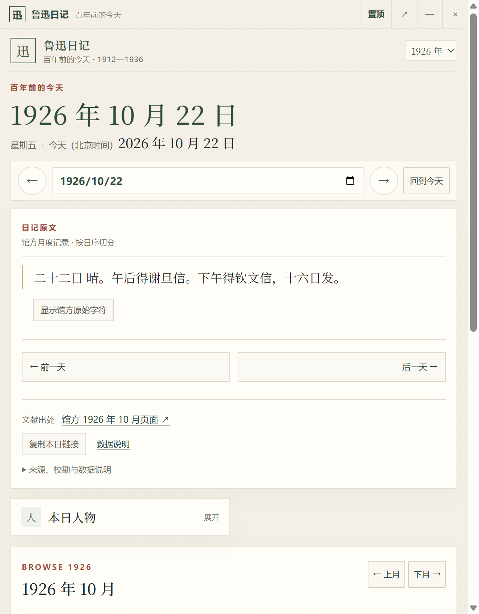

# 鲁迅日记·百年前的今天 — Windows 桌面浮窗

一个常驻桌面的鲁迅日记阅读浮窗。程序本身不内置 8,589 条日记数据，而是加载已经公开的网站与数据：

<https://blueandnight.github.io/luxun-diary/>

因此需要网络连接。界面、日期和内容仍来自《鲁迅日记·百年前的今天》公开站点。

## 预览



## 功能

- 无边框小窗，默认置顶
- 标题栏可拖动，右侧显示置顶、打开完整网站、最小化、收起到托盘
- 默认显示北京时间“百年前的今天”
- 完整保留网站的年份、日期、原文、导航和深链交互
- 托盘图标：显示/隐藏、置顶、刷新、打开完整网站、退出
- 记忆窗口大小和位置
- 开机启动（仅打包版可用）

## 使用

直接运行：

```text
dist/LuXunDiaryWidget-1.0.0-portable.exe
```

首次运行需要联网加载站点。点击标题栏 `↗` 可用默认浏览器打开完整网站；`×` 会收起到系统托盘，退出请使用托盘菜单。

> 当前便携版没有代码签名证书，Windows SmartScreen 可能提示“未知发布者”。选择“更多信息 → 仍要运行”即可。

## 开发

```bash
npm install
npm start
```

开发时需要 Electron 二进制；若 `npm install` 因网络无法下载 Electron，可设置镜像后补装：

```powershell
$env:ELECTRON_MIRROR="https://npmmirror.com/mirrors/electron/"
node node_modules/electron/install.js
```

## 打包

```bash
npm run dist
```

输出为 Windows x64 便携版 exe，不需要安装器。

## 数据与许可

- **程序代码**：MIT。
- **日记数据**：不包含在本桌面程序中；程序仅加载公开站点，日记转录的权利与转载条件见站点仓库的 `DATA_NOTICE.md`。桌面程序不会额外授予数据许可。

## 安全设计

- 渲染进程启用 `sandbox`、`contextIsolation`，关闭 `nodeIntegration`
- 页面是远程公开站点，但渲染进程没有本机文件系统或任意原生能力
- 只向页面暴露最小化的窗口控制 API；IPC 会校验发送者
- 默认拒绝摄像头、麦克风、定位、通知等权限，只允许复制链接所需的剪贴板写入
- 外部链接交给默认浏览器打开，不在内嵌页面中加载
- 不内置日记数据，不读取本机文档目录

## 已知限制

- 需要联网；没有离线数据包。
- 站点结构若发生大改，标题栏注入或布局可能需要跟随调整。
- 仅支持 Windows x64。
